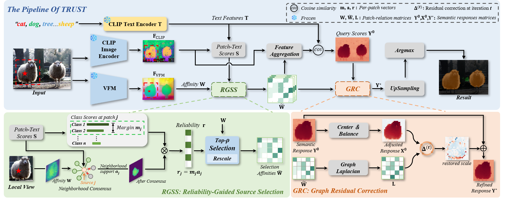

# TRUST

Implementation of **TRUST Before You Propagate: Reliable Source Selection for Training-Free Open-Vocabulary Segmentation**, built on NACLIP.



TRUST combines native NACLIP features, reliable source selection, feature aggregation, and graph residual correction.

## Installation

Use Python 3.10 or 3.11. Install a CUDA-enabled PyTorch build and a compatible compiled MMCV wheel, then install the remaining dependencies:

```bash
pip install -r requirements.txt
git clone https://github.com/facebookresearch/dinov3.git third_party/dinov3
```

Place the checkpoints at:

```text
weights/ViT-B-16.pt
weights/dinov3_vitb16.pth
```

## Evaluation

Windows CMD:

```bat
conda activate clip
python run.py voc21 --data-root E:/DLearn/Dataset/VOCdevkit/VOC2012
```

Linux:

```bash
python run.py voc21 --data-root /data/VOC2012
```

Supported datasets: `voc20`, `voc21`, `context59`, `context60`, `cityscapes`, `ade20k`, `coco_object`, and `coco_stuff164k`. See [dataset layouts](docs/data.md).

Each command evaluates the full validation split and saves the predicted masks, palette, evaluation configuration, logs, confusion matrix, and mIoU under `outputs/`. Predictions retain the original image dimensions. Existing output directories are refused.

Use `python run.py --help` for checkpoint and output paths.

## Results

See [reported results](docs/paper_results.md). Scores are transcribed from the manuscript and supplied records; this packaging update did not rerun benchmarks.

## Code

- `base_model.py`, `clip/`, `prompts/`: NACLIP inference.
- `trust/dino.py`, `trust/graph.py`: external visual features and associations.
- `trust/rgss.py`: reliable source selection.
- `trust/grc.py`: graph residual correction.
- `trust/model.py`: complete model.
- `run.py`: evaluation entry point.

See [method overview](docs/method.md) and [license notes](LICENSE_NOTES.md).

Upstream projects: [NACLIP](https://github.com/sinahmr/NACLIP), [CLIP](https://github.com/openai/CLIP), and [DINOv3](https://github.com/facebookresearch/dinov3).
